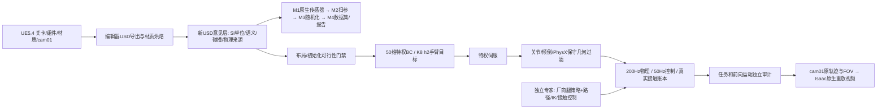

# 管线架构与运行边界

## 模块映射

| 层 | 入口/实现 | 重要不变量 |
|---|---|---|
| UE | pipeline/ue/export_scene.py | 只导出已加载对象；USD/Python插件；烘焙1024贴图；记录未映射组件 |
| USD | pipeline/ue_isaac_pipeline/usd_pipeline.py | 原文件不覆盖；静态建筑和动态目标分开；来源不确定则显式标记 |
| 材质 | pipeline/native/material_profile_apartment.py 与材质审计/配对工具 | 七项修复用新意见层；该profile只适用原公寓命名，非万能识别器 |
| M1 | pipeline/simforge/sensors | 原生RGB、深度、分割、紧/松2D框、3D框、K/外参；空通道失败，不估算补框 |
| M2 | pipeline/simforge/physics | 固定上肢/手指/机体指令，厂商腿部反馈保留；质量/摩擦扫参不是策略训练 |
| M3 | pipeline/simforge/randomize | 分维独立随机流、episode-start采样、0.15m真实表面净空、帧0镜头属性一致 |
| M4 | pipeline/simforge/dataset 与 cli | 原生实例掩码精确转换COCO；缓存哈希、指标证据、失败收据可核对 |
| BC | training/privileged.py / train.py / extract.py | 50→256→256→112；K8/h2；真实物理时钟；归一化仅拟合真实训练数据 |
| 执行层 | training/safe_execute.py / contact_resolve.py | 伺服→限幅/收缩/保持；新的链节碰撞不能沿用旧接触豁免 |
| 评测 | training/evaluate.py | bc/safe/expert/preflight分账；新目录；计真实BC调用；缺测null |
| 渲染 | pipeline/native/render_apartment_physics_movie.py | 成片需要源任务/行走审计；重放关闭物理，时间压缩明确记账 |

## 三种环境

普通Python3.12环境用于数据结构、USD、规划和离线测试；依赖由requirements.txt锁定。UE编辑器自带Python处理unreal，不能从普通Python假装调用UE。Isaac Sim4.5的Python3.10提供原生USD/PhysX/Replicator；Isaac Lab2.1.0、厂商机器人和ONNX按其文档配置，原生约束在configs/requirements-native-constraints.txt。

`--mode bc`使用纯特权BC原生worker；`safe`增加特权伺服/过滤；`expert`不走BC；`preflight`只做历史v2场景门禁。原生worker仍保留公寓特定目标路径和控制阶段，新场景需要新映射、规划和物理审计，不能只改一个文件名便宣称泛化。

## 发布与数据边界

源码仓库只含清洗后的源代码、模板、schema、文档和汇总。运行中的路径/进程/逐拍JSON属于使用者本地输出，不上传。本地发布历史与旧实验Git历史隔离；旧私有远程不在本轮改写。下载者可快检代码和观看公开视频，无法在缺少许可资产/权重时原样重现公寓实测。
